<picture>
  <source media="(prefers-color-scheme: dark)" srcset="./assets/adhd-hero-dark.svg">
  
</picture>

<b>NARESH KUMAWAT</b> · Full Stack Developer | Software Development | AI-Powered Applications | Problem Solver | Open-Source Contributor

 

**In focus.** Hi, I'm Naresh Kumawat, a Computer Science student at Jawaharlal Nehru University. I'm passionate about full-stack development and building real-world applications. I work with C++, JavaScript, TypeScript, React.js, Next.js, Node.js, Express.js, MongoDB, and PostgreSQL. I'm also interested in AI-powered applications and open-source contributions. I enjoy learning new technologies, solving problems, and building projects.

**Currently hyperfocused on:** Currently building full-stack applications, exploring AI-powered solutions, contributing to open-source projects, and strengthening my problem-solving skills.

#### Open tabs

- `TAB 01` **[Supportassistant](https://github.com/Nareshkumawat-star/Supportassistant)**  
  TypeScript · ★ 1
- `TAB 02` **[contestpulse](https://github.com/Nareshkumawat-star/contestpulse)**  
  HTML
- `TAB 03` **[chatrandoms](https://github.com/Nareshkumawat-star/chatrandoms)**  
  JavaScript
- `TAB 04` **[Hivemind-ai](https://github.com/Nareshkumawat-star/Hivemind-ai)**  
  JavaScript

<picture>
  <source media="(prefers-color-scheme: dark)" srcset="./assets/adhd-end-dark.svg">
  
</picture>

